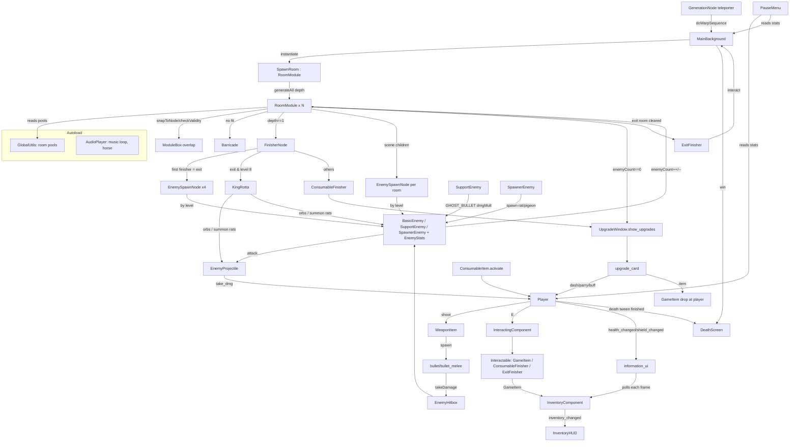

# Streets of Sibiu — Godot → Kotlin/libGDX (Android) Migration Plan

**Status:** audit approved on 2026-10-15. Every recommendation in §9 was accepted (Q7: the launcher icon is derived from the player sprite). Progress is tracked in `MIGRATION_STATUS.md`. The original Godot project stays read-only.

| Item | Value |
|---|---|
| Source project | `2026-Game_of_the_year-main/newgame/` (Godot **4.6**, GDScript, renderer "Forward Plus") |
| Original archive | `2026-Game_of_the_year-main.zip` (left untouched) |
| Target | Kotlin + Gradle + libGDX, Android (existing Android Studio project `StreetsofSibiu/`, module `:app`, namespace `ro.klooseduard.streetsofsibiu`, AGP 9.4.1, minSdk 23, compileSdk/targetSdk 37) |
| Audit date | 2026-10-15 |
| Audit method | Read all 42 GDScript files, all 57 `.tscn` scenes, all 24 `.tres` resources, `project.godot`, bus layout, export presets and import settings. Decoded the binary `TileMapLayer` data of all 21 room scenes with a read-only Python script. Measured every image and audio file. |
| Not available | No Godot editor on this machine, so nothing could be run. Items that depend on runtime engine behaviour are marked **[V#]** (verification items, §8.3). |

---

## 0. Executive summary

* **Game type:** a top-down 2D roguelite with 8 levels. Each level is built procedurally from hand-made room modules, using 100×100 px tiles. You fight rats, pigeons, thieves, criminals, ghosts (buffers), manholes (spawners) and a final boss, King Rotta. Clearing rooms gives upgrade cards. The exit room of each level unlocks weapons, dashes and parries in a fixed order. Clearing level 8 shows "YOU WIN".
* **Size:** about 2,500 lines of GDScript, 20 room modules (plus an unused test room), 53 images, 16 MP3s and 1 shader. There are **no plugins, no save/load system and no networking**.
* **Framework decision: libGDX is appropriate.** The audit found no strong technical reason to pick another framework. libGDX provides SpriteBatch rendering, Scene2D UI, MP3 playback on Android and desktop, touch, keyboard and mouse input, GLSL shaders, FreeType fonts and a desktop backend for side-by-side testing.
  **Box2D is not recommended.** The game relies on Godot's *kinematic* `CharacterBody2D.move_and_slide()` behaviour, Area2D overlap signals, a RayCast2D and Godot's NavigationServer. Box2D is a dynamic rigid-body simulator and would change the movement feel. A small, purpose-built collision, overlap and navigation layer in plain Kotlin is both simpler and more faithful (§6, R1–R3).
* **The biggest unavoidable difference** is input. The original uses keyboard and mouse only (WASD, mouse aim, left/right click, Space, E, R, P, 1–5). Android needs a touch scheme, which is decision **Q1** (§9).
* **Audit findings you need to know before approving:**
  1. `death_screen.gd` (line 28) and `pause_menu.gd` (line 47) use space/tab-mixed indentation. Godot 4's GDScript tokenizer normally rejects this. In that case the pause menu and death screen would be broken in the snapshot I received **[V1]**, so I need to know which behaviour to port (Q4).
  2. Several original behaviours look like bugs but affect gameplay. For example, the Medium Dash leaves the player permanently invulnerable until the next room change, and the ghost buff has no effect because a float is truncated to an int. The full list is in §7. Each one needs a *preserve / fix* decision (Q3). The default in this plan is **preserve**.
  3. Some behaviour only emerges from the Godot engine and is not written in any script. Examples: all enemy projectiles share one collision rectangle, re-enabling an area re-fires its signal (this drives enemy attack loops), and navigation search limits. These must be re-implemented on purpose (§6).

---

## 1. Complete inventory

### 1.1 Project configuration (`project.godot` and related)

| Setting | Value | Migration relevance |
|---|---|---|
| Main scene | `res://main_menu/main_menu.tscn` (uid `d18guy1u0r0uk`) | First screen |
| Autoloads | `AudioPlayer` → `AudioPlayer.tscn` (music + horse easter egg); `GlobalUtils` → `GlobalUtils.gd` (room pools) | Become singletons/objects |
| Viewport | 1920 × 1080, window mode 3 (**fullscreen**). No stretch mode is set (default `disabled`), so the world is shown 1:1 at the window resolution | Aspect ratio decision Q2 |
| Texture filter | `default_texture_filter=0` → **Nearest**. All PNG imports are lossless, without mipmaps, with `fix_alpha_border=true` | libGDX `TextureFilter.Nearest`, no mipmaps |
| Physics | Godot defaults: 60 ticks/s, no physics interpolation | Fixed 60 Hz logic step |
| GUI | `tooltip_delay_sec=0.1` | Tooltips → long-press on Android (difference D5) |
| Audio buses (`default_bus_layout.tres`) | Master −5.93 dB, Music −5.93 dB → Master, SFX −10.25 dB → Master | Bus mixer in Kotlin |
| Input map | `move_forward`=W, `move_backward`=S, `move_leftward`=A, `move_rightward`=D, `blink`=Space, `interact`=E, `reload`=R, `escape`=**P** (pause), `slot_1..5`=1..5, `shoot`=Left mouse, `parry`=Right mouse, `upgrade`=(no events, unused) | Touch scheme Q1; keyboard/mouse kept for desktop/dev and Android with keyboard |
| Export presets | Web only (`export_presets.cfg`) | Not migrated |
| `.gitignore` | `.godot/`, `/android/` (root `.gitignore` also ignores `addons/`) | No `addons/` folder exists, so **no plugins** |
| Engine metadata | 70 `.import` files, 39 `.uid` files, no `.godot/` cache | Not migrated. They only map UIDs to paths. Reference data such as texture sizes was taken from the source files. |

### 1.2 Scripts (42 `.gd` files, 2,490 lines)

| Script | Lines | extends → class_name | Role | Used? |
|---|---|---|---|---|
| `GlobalUtils.gd` | 57 | Node | Autoload. Room scene pools: `roomSceneList`, `finishers`, `fourWays`, `threeWays`, `smallTwoWays`, `bigTwoWays` | Yes |
| `audio_player.gd` | 20 | Node2D | Autoload. Restarts the music when it finishes. Horse sound has a 1/250 chance per second | Yes |
| `horse.gd` | 16 | Node2D | Duplicate of the horse logic | **Unused** |
| `tutorial.gd` | 4 | Control | Tutorial "Start" → `MainBackground.tscn` | Yes |
| `death_screen.gd` | 45 | CanvasLayer | Death/win screen, stats text, fade, Retry / Main Menu. **Mixed indentation, line 28 [V1]** | Yes |
| `pause_menu.gd` | 58 | CanvasLayer | P toggles pause, stats, Settings, Main Menu. **Mixed indentation, line 47 [V1]** | Yes |
| `main_menu/main_menu.gd` | 22 | Control | Start (shows tutorial), Options, Exit, "Cool thingo" CRT toggle | Yes |
| `scenes/settings.gd` | 7 | Control | Go Back (hide when inside the pause menu, otherwise go to the main menu) | Yes |
| `scenes/h_slider.gd` | 14 | HSlider | Bus volume slider (linear ↔ dB) | Yes |
| `player/player.gd` | 379 | CharacterBody2D → **Player** | Movement, dash, parry, damage, buffs, stats, death, weapon sound | Yes |
| `player/bullet.gd` | 39 | Area2D | Player projectile, used for both ranged and melee | Yes |
| `player/ghost.gd` | 20 | Sprite2D | Dash afterimage, fades out | Yes |
| `enemy/IEnemy.gd` | 227 | CharacterBody2D → **IEnemy** | Enemy base: initialize, sprite animation, damage, death, size roll, level scaling | Yes |
| `enemy/enemy.gd` | 121 | IEnemy → **BasicEnemy** | Rat/pigeon/thief/criminal AI: aggro, line of sight, navigation, attack | Yes |
| `enemy/SupportEnemy.gd` | 26 | IEnemy → **SupportEnemy** | Ghost: sends buff orbs to BasicEnemies in range | Yes |
| `enemy/SpawnerEnemy.gd` | 46 | IEnemy → **SpawnerEnemy** | Manhole ("marshmallow"): spawns rats and pigeons | Yes |
| `enemy/KingRotta.gd` | 99 | IEnemy → **KingRotta** | Boss: shotgun volleys, charge, phase 2 summons | Yes |
| `enemy/EnemyHitbox.gd` | 8 | StaticBody2D → **EnemyHitbox** | Forwards `takeDamage` to the parent enemy | Yes |
| `enemy/EnemySpawnNode.gd` | 89 | Node2D → **EnemySpawnNode** | Per-level enemy spawn table | Yes |
| `enemy/enemy_projectile/enemy_projectile.gd` | 61 | Area2D → **EnemyProjectile** | All enemy attacks | Yes |
| `enemy/enemy_types/EnemyStats.gd` | 15 | Resource → **EnemyStats** | Enemy stat block | Yes |
| `background/main_background.gd` | 113 | Node2D → **MainBackground** | Game scene root: levels, warps, camera limits, player clamp | Yes |
| `background/Module.gd` | 192 | Node2D → **RoomModule** | Room: procedural generation, validity check, enemy count, rewards, warps | Yes |
| `background/module_box.gd` | 16 | Area2D → **ModuleBox** | Room bounds overlap check | Yes |
| `background/generation_node.gd` | 29 | Node2D → **GenerationNode** | Door: orientation, teleporter, arrival point, barricade | Yes |
| `background/Barricade.gd` | 22 | Node2D → **Barricade** | Fills a closed doorway with cone tiles | Yes |
| `background/FinisherSpecialNode.gd` | 40 | Node2D → **FinisherNode** | Dead-end room content: exit (enemies/boss) or consumable bin | Yes |
| `background/finishers/ConsumableFinisher.gd` | 19 | Node2D | Garbage bin → consumable choice | Yes |
| `background/finishers/ExitFinisher.gd` | 20 | Node2D | Manhole portal → next level | Yes |
| `item/item_data.gd` | 15 | Resource → **ItemData** | Base item (name, description, icon, type) | Yes |
| `item/weapon_item.gd` | 140 | ItemData → **WeaponItem** | Shooting, ammo, reload, crit, chainsaw ramp-up | Yes |
| `item/consumable_item.gd` | 45 | ItemData → **ConsumableItem** | Potions and buffs | Yes |
| `inventory/inventory_component.gd` | 56 | Node → **InventoryComponent** | 5 slots, add/swap, equip/unequip | Yes |
| `inventory/inventory_ui.gd` | 46 | CanvasLayer | Inventory HUD | Yes |
| `inventory/inventory_slot.gd` | 15 | TextureRect | BBCode tooltip | Yes |
| `inventory/information_ui.gd` | 45 | CanvasLayer | HP bar, shield and ammo labels | Yes |
| `interaction_system/interactable.gd` | 7 | Area2D | Interactable (name, flag, callable) | Yes |
| `interaction_system/interacting_component.gd` | 35 | Node2D | Player's "E" interaction and nearest-target label | Yes |
| `interaction_system/item_placeholder.gd` | 35 | Area2D → **GameItem** | Pickup on the ground, swap | Yes |
| `upgradestings/upgrade_window.gd` | 169 | CanvasLayer | Upgrade pools and card presentation, pauses the game | Yes |
| `upgradestings/upgrade_card.gd` | 43 | Panel | Applies the chosen upgrade | Yes |
| `upgradestings/takeupgradebutton.gd` | 15 | Button | Empty stub | **Unused** |

### 1.3 Scenes (57 `.tscn` files)

**Runtime scenes (used):**

| Scene | Root (type) | Script | Notes |
|---|---|---|---|
| `main_menu/main_menu.tscn` | MainMenu (Control) | main_menu.gd | `menu.png` background, title, 3 buttons, "Cool thingo" button, CRT `ColorRect` (shader), `TutorialScreen` instance |
| `tutorial.tscn` | Tutorial (Control) | tutorial.gd | Controls text + Start button |
| `scenes/Settings.tscn` | Settings (Control) | settings.gd | 3 sliders: Master/Music/SFX (step 0.05). Used standalone and inside PauseMenu |
| `background/MainBackground.tscn` | MainBackground (Node2D) | main_background.gd | Player (+`CoolCamera`), `Overlay/BlackScreen`, Item_placeholder (Punch), InventoryHUD, information_ui, PauseMenu, UpgradeWindow |
| `player/Player_Placeholder.tscn` | Player (CharacterBody2D) | player.gd | Sprite + AnimationPlayer (4 walk animations), capsule r30/h85, timers, InteractingComponent, Inventory, 8 sound players |
| `player/bullet.tscn` | bullet (Area2D) | bullet.gd | Ranged, capsule r11/h32 rotated 90°, `bullet_player.png` |
| `player/bullet_melee.tscn` | bullet (Area2D) | bullet.gd | Melee, capsule r36/h92, `isMelee=true` |
| `player/ghost.tscn` | Ghost (Sprite2D) | ghost.gd | Afterimage |
| `death_screen.tscn` | DeathScreen (CanvasLayer, PROCESS_ALWAYS) | death_screen.gd | Fonts "Hack" 750 / "JetBrains Mono NL" |
| `pause_menu.tscn` | PauseMenu (CanvasLayer, PROCESS_ALWAYS) | pause_menu.gd | Embeds Settings |
| `AudioPlayer.tscn` | AudioPlayer (Node2D) | audio_player.gd | Autoload. Music `bucurest_hroma.mp3` (PROCESS_ALWAYS, Music bus), Horse (SFX bus), HorseTimer 1 s |
| `enemy/Enemy.tscn` | Enemy (CharacterBody2D, floating) | enemy.gd | Body circle r10, EnemyHitbox r27, NavigationAgent2D, Tick 1 s, RayCast2D, AgroRange, HitRange, HealthBar, 4 sounds |
| `enemy/EnemyHitbox.tscn` | EnemyHitbox (StaticBody2D, layer/mask 4) | EnemyHitbox.gd | |
| `enemy/SupportEnemy.tscn` | SupportEnemy (CharacterBody2D) | SupportEnemy.gd | Hitbox r21.26, **no body shape**, BuffArea, Tick 1 s |
| `enemy/SpawnerEnemy.tscn` | SpawnerEnemy (CharacterBody2D) | SpawnerEnemy.gd | Hitbox r33.38, **no body shape**, sprite placeholder `icon.svg` (replaced at runtime), SpawnSound |
| `enemy/KingRottaBoss.tscn` | KingRottaBoss (CharacterBody2D, floating) | KingRotta.gd | Hitbox r146.58, body r103.04, shadow, crown, AttackTimer |
| `enemy/EnemySpawnNode.tscn` | EnemySpawnNode (Node2D) | EnemySpawnNode.gd | **`spawnRadius = null` stored in the scene [V2]** |
| `enemy/enemy_projectile/EnemyProjectile.tscn` | EnemyProjectile (Area2D) | enemy_projectile.gd | **One RectangleShape2D sub-resource shared by all instances** (see §6, E12) |
| `background/GenerationNode.tscn` | GenerationNode (Node2D) | generation_node.gd | Teleporter area (5,0), ArrivalNode (11,0), Preventer StaticBody (2,0). Scaled per room |
| `background/ModuleBox.tscn` | ModuleBox (Area2D) | module_box.gd | Signal `body_exited` connected to a **missing method** (no effect) |
| `background/Barricade.tscn` | Barricade (Node2D) | Barricade.gd | TileMapLayer using `cone.png` 100×100 with full collision |
| `background/FinisherSpecialNode.tscn` | FinisherSpecialNode (Node2D) | FinisherSpecialNode.gd | Empty Label, hidden `diagonals.png` sprite |
| `background/finishers/ConsumableFinisher.tscn` | ConsumableFinisher (Node2D) | ConsumableFinisher.gd | `garbagebin.png`, Interactable rect 132×217, "Choose a consumable" |
| `background/finishers/ExitFinisher.tscn` | ExitFinisher (Node2D) | ExitFinisher.gd | `manhole_portal.png`, Interactable rect 219×310.5, "Exit Level" |
| `interaction_system/interactable.tscn` | Interactable (Area2D, layer 2, mask 0) | interactable.gd | |
| `interaction_system/interacting_component.tscn` | InteractingComponent (Node2D) | interacting_component.gd | InteractRange circle r30 × scale 1.5, mask 2. InteractLabel |
| `interaction_system/item_placeholder.tscn` | Item_placeholder (Area2D, z 13) | item_placeholder.gd | Body circle r64, Interactable circle r95 |
| `inventory/inventory_ui.tscn` | InventoryHUD (CanvasLayer) | inventory_ui.gd | Bottom-left, scale 0.75, 3 weapon slots 128×128 + 2 consumable slots, theme font "JetBrains Mono" |
| `inventory/information_ui.tscn` | information_ui (CanvasLayer) | information_ui.gd | Top-left panel 410×115: HP bar, shield icon + label, ammo label |
| `upgradestings/upgrade window.tscn` | UpgradeWindow (CanvasLayer, PROCESS_ALWAYS) | upgrade_window.gd | 3 card references, `item_drop_scene` = item_placeholder |
| `upgradestings/select_upgrade_scene.tscn` | SelectUpgrade (Control) | — | Tinted backdrop, HBox of 3 cards (sets non-existent `sprite`/`textdesc` properties, which are ignored) |
| `upgradestings/upgrade_card.tscn` | Panel (Panel) | upgrade_card.gd | 400×500 card, TextureRect, RichTextLabel (BBCode), full-size Button |

**Room modules (20, all `RoomModule` with the same tile definitions, decoded; the 21st decoded scene, `DummyRoom`, is unused):**

| Module | Tile grid (cells) | Doors (GenerationNodes) | ModuleBox centre / size | EnemySpawnNodes | Pool(s) |
|---|---|---|---|---|---|
| `SpawnRoom` | 20×11 (220) | W, E, N, S | (996,545) / 1954×1040.25 | 0 | start room |
| `FIGHTROOM_12` | 20×11 | W, S | (996,545) | 2 (r=100) | smallTwoWays |
| `FIGHTROOM_13_SMALL` | 20×11 | W, E | (996,545) | 2 (r=100) | smallTwoWays |
| `FIGHTROOM_34_SMALL` | 20×11 | E, N | (996,545) | 2 (r=100) | smallTwoWays |
| `FIGHTROOM_123_SMALL` | 20×11 | W, E, S | (996,545) | 2 (r=100) | threeWays |
| `FIGHTROOM_124_SMALL` | 20×11 | W, N, S | (1000,544) | 2 (r=100) | threeWays |
| `FIGHTROOM_134_SMALL` | 20×11 | W, E, N | (996,545) | 2 (r=100) | threeWays |
| `FIGHTROOM_234_SMALL` | 20×11 | E, N, S | (996,545) | 2 (r=100) | threeWays |
| `FIGHTROOM_1234_SMALL` | 20×11 | W, E, N, S | (996,545) | 2 (r=100) | fourWays |
| `FIGHTROOM_12_MEDIUM` | 21×30 (630) | W, S | (1046.25,1492.94) | 4 (**r unset [V2]**) | bigTwoWays |
| `FIGHTROOM_13_MEDIUM` | 21×30 | W, E | same | 4 (r unset) | bigTwoWays |
| `FIGHTROOM_24_MEDIUM` | 21×30 | N, S | same | 4 (r unset) | bigTwoWays |
| `FIGHTROOM_12_BIG` | 49×37 (1813) | W, S | (2454,1150) | 6 (r unset) | bigTwoWays |
| `FIGHTROOM_13_BIG` | 49×36 (1764) | W, E | (2454,1194.5) | 7 (r unset) | bigTwoWays |
| `FIGHTROOM_34_BIG` | 83×11 (913) | E, N | (4141.5,545) | 6 (r=100) | bigTwoWays |
| `FIGHTROOMBIGENEMY_1` | 21×21 (441) | W | (1049.5,1052) / 1997×2018 | 0 | finishers |
| `FIGHTROOMBIGENEMY_2` | 21×21 | S | same | 0 | finishers |
| `FIGHTROOMBIGENEMY_3` | 21×21 | E | same | 0 | finishers |
| `FIGHTROOMBIGENEMY_4` | 21×21 | N | same | 0 | finishers |
| `FIGHTROOMBIGENEMY_1234` | 21×21 | W, E, N, S | same | 0 | fourWays |

Tile definitions (identical in every room, 8×5 atlas of `tilesetbig.png`, 100×100 tiles): **solid** (full-square collision on layer 1) = row 0 except (1,0), plus all of row 4. **Walkable** (navigation layer 2, full-square nav polygon, agent radius 0) = (1,0) and rows 1–3. All cells use source 0 and alternative 0. Some tiles have negative coordinates (BIG rooms reach y = −7).

**Unused scenes (not reachable from the main scene):** `Main.tscn`, `TestingCombat.tscn`, `player/test_ghost.tscn`, `background/DummyRoom.tscn` (uses `placeholderTileset.png`), `interaction_system/world_placeholder.tscn` (a test arena with all items), and the editor leftover `background/MainBackground.tscn14552369758.tmp`. **These will not be migrated.** They are listed in the differences register as "not ported – unreachable" (D-U1).

### 1.4 Data resources (24 `.tres`)

* **Enemy types** (`enemy/enemy_types/*.tres`, EnemyStats): Rat, Pigeon, Thief, Criminal, Ghost, MarshMallow, KingRotta. Values are in §3.6.
* **Weapons** (`item/weapons/**.tres`, WeaponItem): primary_medium (Rifle), primary_short (SMG), primary_alternative (Negev), primary_sniper. secondary_punch, secondary_knife, secondary_bat, secondary_chainsaw. Values are in §3.3.
* **Consumables** (`item/consumables/*.tres`, ConsumableItem): health, shield, speed, x2dmg (Rage), dmg_reduction (Armor), enemy_stun, ghost, ups_and_downs (Adrenaline). Values are in §3.4.
* `default_bus_layout.tres` (audio buses).

### 1.5 Assets

**Images (52 PNG + 1 SVG).** All load with Nearest filtering and no mipmaps.

| File | Size (px) | Used by | Status |
|---|---|---|---|
| `tilesetbig.png` | 800×500 | All room TileMaps (8×5 tiles) | used |
| `cone.png` | 100×100 | Barricade tiles | used |
| `menu.png` | 1920×1080 (1.3 MB) | Main menu + Settings background | used |
| `icon.svg` | 128×128 vector | Project icon; SpawnerEnemy placeholder sprite (replaced before the first draw) | see §5 |
| `player/player_assets/playerassets.png` | 234×408 (3×4 frames of 78×102) | Player, Ghost | used |
| `player/player_assets/diagonals.png` | 117×76 | FinisherSpecialNode (hidden sprite) | used (invisible) |
| `enemy/enemy_assets/Rat Spritesheet.png` | 162×60 (2×2) | Rat | used |
| `enemy/enemy_assets/PigeonSpritesheet.png` | 148×260 (2×2) | Pigeon | used |
| `enemy/enemy_assets/thiefAssets.png` | 234×408 (3×4) | Thief | used |
| `enemy/enemy_assets/criminalAssets.png` | 234×408 (3×4) | Criminal | used |
| `enemy/enemy_assets/manhole.png` | 96×91 | Spawner ("marshmallow") | used |
| `enemy/enemy_assets/ghost.png` | 66×97 | Support ghost | used |
| `enemy/enemy_assets/KingRotta.png` | 108×115 (2×1) | Boss | used |
| `enemy/enemy_assets/floating_crown.png` | 24×24 | Boss crown | used |
| `enemy/enemy_assets/rat_shadow.png` | 52×32 | Boss shadow | used |
| `enemy/enemy_projectile/enemy_projectile_assets/claw.png` | 128×120 | BASIC_SLASH | used |
| `…/bullet.png` | 70×30 | BASIC_BULLET; upgrade icon | used |
| `…/the_orb.png` | 100×100 | KING_ROTTA_BULLET | used |
| `…/the_orb_GHOST.png` | 100×100 | GHOST_BULLET | used |
| `item/item_assets/bullet_player.png` | 25×15 | Player ranged bullet | used |
| `item/item_assets/lines.png` | 117×76 | Melee bullet default sprite (always replaced by the weapon icon, see §3.3) | effectively invisible |
| `item/item_assets/item icons/` — `rifle, smg, negev, sniper, Shield, heal bottle, newbottle1–4, dash1, dash2, normaldash, parry1–3` | 300×150 | Items, cards, HUD | used |
| `item icons/` — `bat, chainsaw, knife, punch` | 100×100 | Melee items, CRIMINAL_SLASH sprite | used |
| `item icons/invslot.png` | 128×128 | Empty inventory slot | used |
| `background/finishers/garbagebin.png` | 100×100 | ConsumableFinisher | used |
| `background/background_assets/manhole_portal.png` | 78×63 | ExitFinisher | used |
| **Unused:** `barrel.png`, `crazy_tileset.png`, `placeholder.png`, `placeholderTileset.png` (DummyRoom only), `garbagebin.png` (root, identical copy), `main_menu/bg5.png`, `background/background_assets/one slope.png`, `enemy/enemy_assets/long diagonals.png`, `enemy/enemy_assets/playerassets.png` (identical to the player sheet), `item icons/blackjack_icon.png` | | | not ported |

**Audio (16 MP3).** None loop at import (`loop=false`).

| File | Duration | Used by | Bus |
|---|---|---|---|
| `bucurest_hroma.mp3` | 138.3 s | Background music (autoload, restarted on `finished`, keeps playing while paused) | Music |
| `Music/Horse.mp3` | 1.2 s | Easter egg, 1/250 chance each second | SFX |
| `Music/Dash.mp3` | 0.31 s | Dash | SFX |
| `Music/Parry.mp3` | 1.56 s | Parry | SFX |
| `Music/PotionGulp.mp3` | 0.63 s | Consumable used | SFX |
| `Music/PlayerDeath.mp3` | 3.70 s | Death (PROCESS_ALWAYS) | **Master** (no bus set) |
| `Music/Gunshot.mp3` | 0.29 s | All primaries (non-positional player created per shot) | SFX |
| `Music/Slash.mp3` | 0.26 s | Punch, knife, bat | SFX |
| `Music/Chainsaw.mp3` | 0.24 s | Chainsaw | SFX |
| `Music/Rat.mp3` | 0.55 s | Rat attack | SFX |
| `Music/Pigeon.mp3` | 0.50 s | Pigeon attack | SFX |
| `Music/Grunt.mp3` | 0.62 s | Thief/criminal attack (70 %) | SFX |
| `Music/CeTelefonAi.mp3` | 1.82 s | Thief/criminal attack (30 %) | SFX |
| `Music/EnemySpawner.mp3` | 2.09 s | Spawner spawns | SFX |
| **Unused:** `Music/Reload.mp3`, `main_menu/001. Overworld Night.mp3` | | | not ported |

The Player scene also contains `ShotSound`, `SlashSound` and `ChainsawSound` nodes that are never played.

**Fonts:** **no font files are included.** The scenes reference *system* fonts via `SystemFont`: "Montserrat" (menu title), "JetBrains Mono NL" (stats), "JetBrains Mono" (inventory theme), "Hack" weight 750 ("YOU DIED"). All other text uses Godot's built-in default theme font. What the original actually looked like therefore depended on which fonts were installed on the player's machine **[V11]**. See Q6.

**Shader:** `shader_goesbrrrr.gdshader` (193 lines). A full-screen CRT/VHS post-process using `hint_screen_texture`, `SCREEN_UV`, `SCREEN_PIXEL_SIZE`, `FRAGCOORD`, `TIME` and `textureLod`. It appears only in the main menu, toggled by the "Cool thingo" button. The parameters set in the scene override the shader defaults; for example `curvature=0.0`.

---

## 2. Dependency map

### 2.1 Scene flow

```mermaid
flowchart LR
  MM[main_menu.tscn] -- Start --> TUT[TutorialScreen overlay]
  TUT -- Start --> MB[MainBackground.tscn]
  MM -- Options --> SET[Settings.tscn]
  SET -- Go Back --> MM
  MM -- Exit --> Q((quit))
  MB -- P --> PM[PauseMenu]
  PM -- Settings --> SETI[Settings (embedded)]
  PM -- Main Menu --> MM
  MB -- hp < 1 --> DS[DeathScreen 'YOU DIED']
  MB -- level 8 exit --> WS[DeathScreen 'YOU WIN']
  DS -- Retry --> MB
  DS -- Main Menu --> MM
```

### 2.2 Runtime object and script interactions



### 2.3 Signals and connections

| Emitter | Signal | Receiver | Purpose |
|---|---|---|---|
| Player | `health_changed(hp, max)`, `shield_changed(s)` | information_ui | HUD |
| InventoryComponent | `inventory_changed` | InventoryHUD | Slot refresh |
| RoomModule | `validCheck(bool)` | RoomModule.generateFromNode (awaited) | Generation |
| Timer.timeout | GhostTimer, SlownessTimer, enemy/support `Tick`, spawner `Tick`, AttackTimer, projectile DeathTimer, HorseTimer | owners | gameplay timing |
| Area2D.body_entered | HitRange → attack; Teleporter → warp; EnemyProjectile → hit; bullet (code-connected) → hit; chainsaw ramp lambda | owners | combat / warps |
| Area2D.area_entered/exited | InteractRange | InteractingComponent | interaction list |
| Button.pressed | menu, pause, death, tutorial, settings, card buttons | screens | UI |
| AudioStreamPlayer.finished | music → replay; per-shot players → free | AudioPlayer / Player | audio |
| HSlider.value_changed | volume sliders | h_slider.gd | bus volume |
| Tween.finished | death animation, invincibility end, dash end | Player | state |
| **Broken (no effect):** Enemy `NavigationAgent2D.velocity_computed` → missing `_on_navigation_agent_2d_velocity_computed` (avoidance is off); ModuleBox `body_exited` → missing `_on_body_exited` | | | ignored in the port |

### 2.4 Collision layers and masks

The project has no named layers. Numbers below are bit values.

| Object | layer | mask | Notes |
|---|---|---|---|
| Room TileMap solids, Barricade tiles | 1 | — | 100×100 squares |
| Player (CharacterBody2D, **grounded** motion mode) | 1 | 1 | Collides with walls, enemy bodies, Preventers, barricades |
| Enemy / KingRotta bodies (floating mode) | 1 | 1 | Enemies block each other and the player |
| SupportEnemy / SpawnerEnemy body | 1 | 1 | No body shape, so they block nothing |
| GenerationNode `Preventer` (StaticBody2D) | 1 | 1 | Door blocker, behind the teleporter |
| EnemyHitbox (StaticBody2D) | 4 | 4 | Only player bullets see it |
| Player bullets (Area2D) | 5 (1+4) | 5 | See walls, Preventers, bodies, hitboxes |
| EnemyProjectile, AgroRange, HitRange, BuffArea, Teleporter, ModuleBox, Item_placeholder (Area2D) | 1 | 1 | |
| Interactable (Area2D) | 2 | 0 | |
| InteractRange (Area2D) | 0 | 2 | |
| RayCast2D LineOfSight | — | 1 | Hits walls, player, *other enemies*, Preventers |

### 2.5 Draw order (needed to reproduce rendering)

World, back to front:

1. Room tiles and room props, in tree order.
2. Enemies, enemy projectiles and finisher sprites (z 0, in tree order).
3. Player bullets (z 10).
4. Ground items (z 13).
5. Ghost trail (z 115).
6. Player (z 178 in MainBackground). The interact label is drawn at z +10 relative to the player.

Screen layers: all CanvasLayers use the default layer 1, so they draw in tree order. The order is Overlay/BlackScreen → InventoryHUD → information_ui → PauseMenu → UpgradeWindow → DeathScreen (added last). **The HUD therefore stays visible above the black transition screen.**

### 2.6 Pause and process-mode map

`get_tree().paused` is set by the PauseMenu, the UpgradeWindow and the DeathScreen.

* **Keeps running while paused** (PROCESS_ALWAYS): PauseMenu, UpgradeWindow, DeathScreen, music player, player death sound, and `CoolCamera` (its smoothing keeps running).
* **Stops while paused:** everything else, including timers created with `create_timer(t, 0)` and node-bound tweens.

---

## 3. Gameplay mechanics and constants

All values are taken from code or resources. "px" means world pixels, with 1 tile = 100 px. A "tick" is one physics frame at 60 Hz.

### 3.1 Player movement, dash and parry (`player.gd`, `Player_Placeholder.tscn`)

| Mechanic | Rule / constants |
|---|---|
| Walk | 8-way digital input, normalized. `velocity = dir * 500 * get_stat("speed", 1.0)`. Zero input → velocity 0 and animation stopped. Capsule collider r = 30, height 85 (vertical) |
| Speed stat | `get_stat(name, base)` = base + weapon_modifiers + consumable_modifiers + buff_modifiers |
| Room clamp | Every tick, the player position is clamped to the camera limits shrunk by 40 px on each side |
| Animation | 3×4 sheet, 0.4 s looping, keys every 0.1 s: up [2,0,2,1], down [5,4,5,3], left [8,6,8,7], right [11,10,11,9]. Animation is chosen by the dominant axis. The idle frame after `stop()` needs checking **[V3]**. The initial frame is 0 |
| Dash (Space), shared | Only when not sliding and `DashTimer` is stopped. Plays Dash sound, sets `is_sliding=true`, starts a ghost every 0.15 s plus one immediately |
| Dash **NONE** (starting state) | No teleport and no cooldown, but the slide still starts at walking speed and decays at 3000 px/s². The result is a spammable mini-slide of about 42 px with no control (preserve, B17) |
| Dash **SHORT** (unlocked at level 2) | Teleports 200 px (2 × BLINK_DISTANCE 100) along the input direction with **no collision check**. Then slides from 1200 px/s with friction 3000 px/s² and ends when speed < 10 px/s (about 0.4 s and 240 px). Cooldown 1.0 s. Invulnerable while sliding. Blue tint (0.3,0.5,1,0.6) over 0.1 s, back to white at the end |
| Dash **MEDIUM** (level 4 choice) | Teleport 200 px plus the same slide, cooldown 0.5 s. Current weapon gains +2 ammo, capped at the *base* capacity. The sniper bonus never triggers (`"firerate"` typo, B3). Sets `can_take_dmg=false` and **never restores it** (B2) |
| Dash **LONG** (level 4 choice, "Teleport") | Teleports to the mouse position (anywhere; the room clamp then applies). Cooldown 2.0 s. Base speed 330 (0.66 × 500) for 1.0 s. No invulnerability. Works without directional input |
| Sliding state | No input, shooting, parry or reload. `velocity.move_toward(0, 3000·dt)`. Collisions shorten the slide |
| Parry (right click) | Only when not sliding and `ParryTimer` is stopped. **Starting value `selected_parry = 3` is out of range, so parry does nothing until unlocked** |
| Parry NORMAL (level 5) | Sound, invulnerable 0.2 s, cooldown **1 s** (the card text says 0.5 s), green flash 0.1 + 0.1 s |
| Parry MEDIUM "Reload" (level 6 choice) | Invulnerable 0.2 s, cooldown 1.5 s. Sniper → refill to base capacity. Other guns → +10 ammo, **not capped**. Yellow flash. With a consumable selected this hits a runtime error (B7) |
| Parry CHARGE (level 6 choice) | Cooldown 10 s, speed 0, tint (2,0.5,0.5) (**overbright**, R8), stance lasts 1 s. If hit during the stance: damage ignored, speed 625 for 2 s, parry cooldown = max(0.1, remaining − 4 s), current weapon `dmg` ×**10** for 0.5 s (the card says ×2 for 1 s), tint reset |
| Taking damage `take_dmg(d, invTime)` | Order of checks: `invincible` stat > 0 → ignore; charge stance → counter; `!can_take_dmg` → ignore. If invTime > 0: `can_take_dmg=false` and an alpha flicker of 4 steps × invTime/4 re-enables it (enemy projectiles use 0.1 s). Then `final = max(d − dmg_reduction_raw, 0)`, shield absorbs first, then HP |
| HP / death | maxHp 100, hp 100, shield 0. **The setter fires on any assignment with hp < 1**: death sound, physics off, sprite fades and shrinks to 0 over 1 s (sine), then the death screen. Every further hit repeats this (B18) |
| Room warp | Sets `can_take_dmg = true` (the only general reset) |

### 3.2 Inventory and interaction

* Five slots: `[primary, primary, secondary, consumable, consumable]`. Keys 1–5 select a slot. The starting inventory is **Punch in slot 3 (index 2)**, with slot index 0 selected.
* Changing slots unequips the old item (clears weapon modifiers) and equips the new one. Consumables have no equip effect.
* `add_item` puts a duplicate into the first empty slot of the matching type.
* If no slot is free, `swap_item` only works when the *selected* slot is of that type. It does **not** duplicate the item and does **not** re-equip modifiers (B10, B11). Otherwise it prints "inventory type slots full".
* Using an item: weapons fire while "shoot" is held. Consumables activate on the press itself, and if `activate()` returns true they play PotionGulp and are removed. R reloads.
* Interaction (E): range is a circle of r = 45 px (30 × 1.5) around the player, overlapping Interactable areas. The nearest one is chosen (sorted by distance). Its label is shown 42 px below the player. Input is blocked while an interaction call is awaited.
* Ground items (`GameItem`) show "Pick up X" and, after a swap, "Switch with Y". All GameItems directly under MainBackground are deleted when a level is generated. **This also deletes the Punch placed in `MainBackground.tscn` before it can be reached** (B12).

### 3.3 Weapons (`weapon_item.gd`, `bullet.gd`, `.tres`)

| Weapon | Slot | dmg | ammo | fire rate (/s) | reload (s) | range (px) | bullet speed (px/s) | modifiers while held | other |
|---|---|---|---|---|---|---|---|---|---|
| Punch | secondary | 2 | ∞ (−1) | 5 | — | 150 | 800 | — | melee |
| Knife | secondary | 5 | ∞ | 2.5 | — | 150 | 800 | — | melee |
| Bat | secondary | 8 | ∞ | 2 | — | 250 | 800 | — | melee |
| Chainsaw | secondary | 1 (+ramp) | ∞ | 8 | — | 150 | 800 | — | ramp +0.4 per hit, decay 2.0/s (default) |
| Medium Rifle | primary | 4 | 15 | 3 | 0.75 | 550 | 1200 | — | |
| SMG | primary | 3 | 30 | 9 | 1.5 | 550 | 1300 | speed +0.10 | |
| Negev | primary | 2.5 | 60 | 10 | 2.5 | 650 | 1350 | speed −0.30 | |
| Sniper | primary | 25 | 1 | 10 | 1.0 | 3000 | 1700 | crit +10 | own critChance 10, so **20 % total**. `is_sniper` empties the magazine after each shot |

* **Shot:** blocked while reloading or during the cooldown. With an empty magazine, the press starts a reload instead of firing. Each shot plays the weapon sound on a new non-positional SFX player.
* **Damage** = `(dmg + ramp) × (1 + damage_bonus/100)`. Crit if `randf()×100 < critChance + crit_chance stat`, which doubles the damage.
* **Cooldown** = 1/fire_rate. **Reload time** = `reloadTime − sniper_cooldown_reduction` (applies to *every* weapon). **Capacity** = base + `bonus_weapon_capacity` (applies to every weapon).
* **Chainsaw ramp:** at each shot the stack decays by 2.0 × seconds since the last calculation (minimum 0). The stack grows by 0.4 for **every body with `takeDamage`** the bullet enters, which includes the enemy *body* as well as its hitbox. So a single hit on a basic enemy can add 0.8.
* **Bullets** spawn at the player's centre, aimed at the mouse, and are added (deferred) to MainBackground, so they survive room warps. They move `speed × dt` per tick and despawn after `maxRange`.
  * On EnemyHitbox → damage.
  * Melee bullets pass through enemies. Ranged bullets despawn on their first hit.
  * Any other body (wall, Preventer, barricade, or an enemy body hit before its hitbox) → despawn without damage. Player → ignored.
  * Melee "bullets" display the **weapon icon** sprite.
  * Collider shapes: ranged capsule r11/h32 along the travel direction; melee capsule r36/h92 *perpendicular* to it.

### 3.4 Consumables (`consumable_item.gd`)

| Item | Effect | Duration |
|---|---|---|
| Health Potion | +40 HP up to max_hp. **Only usable if hp < base maxHp 100** (B8) | — |
| Shield | +150 shield; speed −0.33 | 10 s |
| Speed Potion | speed +1.0 | 20 s |
| Rage Potion | damage_bonus +100 | 10 s |
| Armor | dmg_reduction_raw +30 | 10 s |
| Stun Grenade | −20 HP; slown_enemy −1.0 (enemy speed multiplier → 0) | 6 s |
| Ghost | invincible +1 | 5 s |
| Adrenaline | damage_bonus +50, then damage_bonus −50 for 10 s | 20 s |

Buffs are added to and removed from `consumable_modifiers`. Timers pause with the game. `slown_enemy` also changes the global multiplier `Player.slownEnemy`, which can **go negative** when combined with permanent slow upgrades, making enemies walk backwards (B13).

### 3.5 Upgrades and progression (`upgrade_window.gd`, `Module.enableWarps`)

* **Small pool** (3 random of 6): +1 ammo cap & 0.05 s reload reduction / +15 max HP / +1 % speed / +0.5 damage reduction / +2 % damage / +10 shield.
* **Big pool** (3 random of 10): +5 ammo & 0.1 s / +20 max HP / +5 % speed / +2 damage reduction / +50 shield / +3 % crit / +5 % enemy slow (slown −0.05) / +10 % damage / +30 HP & −5 % speed / +25 % damage & −20 max HP.
* **max_hp** buffs also add (or subtract) the same amount of current HP. **shield** goes straight into `shield`.
* **Room reward:** 1 s after a room's enemy count reaches 0 (pausable timer). Small room → small pool. Big room → big pool. Exit room → the fixed sequence below. Then the doors are unlocked.
* **Exit room sequence.** Each window pauses the game, and the next one opens 0.1 s after the previous closes:

| Exit of level | Windows shown, in order |
|---|---|
| 1 | Knife (item), Big |
| 2 | Bat / Chainsaw (item), Short Dash, Big |
| 3 | Medium Rifle (item), Big |
| 4 | Medium Dash / Teleport Dash, Big |
| 5 | SMG / Negev / Sniper (item, not shuffled), Normal Parry, Big |
| 6 | Charge Parry / Reload Parry, Big |
| 7 | Big, Big |
| 8 (boss) | Big |

  After the windows, the ExitFinisher manhole appears. Interacting with it starts the next level. After level 8 it shows "YOU WIN".
* **Item cards** drop a GameItem at the player's position. It must then be picked up with E (secondary items swap only when slot 3 is selected).
* **Garbage-bin finisher** (non-exit dead ends): interacting opens "consumables" (2 random of 8). It can only be used once.
* **Card UI:** cards are hidden, filled, and fade in over 0.3 s (sine). Choosing one fades out over 0.3 s, then unpauses.

### 3.6 Enemies

**Stats** (unset fields use the defaults: vision 300, hp 100, dmg 5, speed 50, reach 50, cooldown 0.2, windup 0.1, size 1.0; `dmgMult` int 1):

| Type | hp | dmg | walk | reach | hitCooldown | windup | size | Per-level scaling (+× (L−1)) |
|---|---|---|---|---|---|---|---|---|
| rat | 10 | 5 | 300 | 50 | 0.7 | 0.1 | 1.0 | hp +3, dmg +1 |
| pigeon | 5 | 2 | 400 | 75 | 0.4 | 0.1 | 1.0 | hp +2, dmg +1 |
| thief | 30 | 5 | 300 | 300 | 0.9 | 0.1 | 1.25 | hp +3, dmg +1.5 |
| criminal | 60 | 20 | 250 | 100 | 1.5 | 0.4 | 1.5 | hp +3, dmg +1.5 |
| ghost (support) | 30 | 0 | 0 | 300 (buff radius) | 0 | 0 | 1.5 | — |
| marshmallow (spawner) | 60 | 0 | 0 | 50 (spawn radius) | 10 (spawn period) | 0 | 1.5 | — |
| king_rotta | 2000 | 40 | 0 | 0 | 10 | 0 | 1.5 | — |

* **Initialize:** stats are deep-copied, then level scaling is applied, then the **size roll**, then the looks. The size roll for size 1.0 gives 10 % stay, 75 % → 1.25 (+20 % hp, +10 % dmg), 15 % → 1.5 (+40 % hp, +20 % dmg). Any 1.25 (rolled or base) then has a 15 % chance → 1.5 (+30 % hp, +15 % dmg).
* The whole node is scaled by `sizeModifier`, including colliders, aggro and hit ranges, sprite and health bar.
* A health bar is hidden until the first damage. It tweens to the new value over 0.4 s. On death: room count −1, dmg and speed set to 0, fade over 0.3 s, then removed.
* Enemies spawned without a `spawnPos` get a random 1–5 px offset.
* **BasicEnemy AI (rat, pigeon, thief, criminal):**
  * `visionRange ×= 10`, so 3000 px; the aggro circle is scaled by the enemy size.
  * Every 1 s (Tick): find the player in the aggro circle, then check line of sight with a RayCast that other enemies can block.
  * With line of sight: `agro += (11 − agro) / 3` (integer division; saturates at 9). Without: `agro −= 1`. At 0: idle.
  * While agro > 0 the navigation target is set to the player position, **even without line of sight**.
  * Each tick when not idle: `velocity = dir_to(next_path_point) × walkSpeed × Player.slownEnemy`, then move_and_slide.
  * Before the first target is set, the agent returns its own position, so the enemy does not move.
* **Navigation agent settings:** navigation layer 2, `path_search_max_distance = 500`, `path_search_max_polygons = 512`, avoidance off. The Godot defaults also apply (path_desired 20, target_desired 10, path_max_distance 100, corridor funnel) **[V8]**.
* **Attack:** triggered when the player *enters* the HitRange circle (radius = reach, scaled).
  1. Disable the HitRange and set walk speed to 0.
  2. Wait `hitWindup`, then aim at the player's current position.
  3. Spawn the projectile and play the sound (rat → Rat; pigeon → Pigeon; thief/criminal → 30 % CeTelefonAi, otherwise Grunt).
  4. Wait `hitCooldown`, then re-enable the HitRange and restore speed. **Re-enabling re-fires `body_entered` while the player is still inside, so attacks repeat [V6]**.
* **Sprite animation:** advances every 15 ticks. Rat (2×2) animates only while moving. Pigeon (2×2) always animates. Thief and criminal (3×4) use a 4-direction row picked from velocity, alternating columns 0/1, with column 2 when standing still.
* **Support ghost:** every 1 s, sends a GHOST_BULLET to each BasicEnemy body inside its buff circle (r 300 × 1.5). The bullet sets `stats.dmgMult = 1.3` on the first BasicEnemy it touches. **The field is an int, so it becomes 1 and the buff has no effect** (B4). The ghost has no body collider.
* **Spawner (manhole):** spawns on ready and then every 10 s while alive: 1 (30 %), 2 (50 %) or 3 (20 %) enemies, rat or pigeon (50/50), at local position + 50 px at a random angle, with the spawn sound. No body collider.
* **King Rotta (level-8 exit room):**
  * The first attack comes 1 s after spawn. Every attack first checks phase 2 (hp ≤ 1000). Phase 2 sets the attack interval to 2 s and summons 6 rats at radius 50.
  * Each attack: 30 % **charge** (dash toward the player at 1500 px/s, decaying linearly to 0 over 0.7 s; next attack after 1 s). Otherwise **shotgun**: phase 1 fires 3 orbs 30° apart; phase 2 fires 2 volleys of 5 orbs 20° apart, 0.1 s apart. The next attack follows after 3 s (phase 1) or 2 s (phase 2).
  * Orbs deal 40 damage, move 30 px/tick, last 4 s and do not pierce.
  * The sprite faces the player. The rat bobs ±5 px and the crown ±10 px (1 s sine loops). No contact damage.

**Enemy projectiles** (`EnemyProjectile.initializeProjectile`, speed in px **per tick**, so frame-rate dependent):

| Attack | Sprite | Speed (px/tick) | Life (s) | Piercing | Notes |
|---|---|---|---|---|---|
| BASIC_SLASH (rat, pigeon) | claw.png (rotated +45°) | 0 | 0.1 | yes | |
| BASIC_BULLET (thief) | bullet.png | 7 | 6 | no | |
| CRIMINAL_SLASH | knife.png (rotated +90°) | 5 | 0.5 | no | |
| KING_ROTTA_BULLET | the_orb.png | 30 | 4 | no | |
| GHOST_BULLET | the_orb_GHOST.png | 4 | 2 | yes | support, "damage" 1.3 = dmgMult |

* Damage = `dmg × dmgMult`. A projectile spawns half its width ahead of the enemy along the aim angle. The hitbox rectangle is set to the sprite size, but it is **one shared shape**, so every live projectile uses the size of the most recently spawned one (E12).
* On hit: Player → `take_dmg(damage, 0.1)` (non-support only), and non-piercing projectiles despawn. Non-enemy bodies (walls, Preventers) destroy non-piercing projectiles.

### 3.7 Spawn tables (`EnemySpawnNode`, per node, using `randi_range` inclusive)

| Level | Count | Types (weights) |
|---|---|---|
| 1 | 1–2 | rat |
| 2 | 2–3 | rat, pigeon (1:1) |
| 3 | 2–4 | rat, pigeon, thief (1:1:1) |
| 4 | 3–4 | pigeon 1, thief 2 |
| 5 | 2–5 | rat, thief, criminal (1:1:1) |
| 6 | 3–5 | rat 3, pigeon 3, thief 4, criminal 2, ghost 1 |
| 7, 8 | 3–5 | rat 2, pigeon 2, thief 4, criminal 2, ghost 1, marshmallow 1 |

The comments in the original source give different ranges from the code. **The code values are used.**

Each enemy spawns at `spawnRadius` px from the node at a random angle (0–359°). Small rooms and `34_BIG` set radius 100; medium and big rooms inherit `null` **[V2]**.

### 3.8 Level generation, rooms, warps (`main_background.gd`, `Module.gd`)

* **Level start** (`finishLevel`):
  1. `currentLevel += 1`. If it is above 8 → win screen.
  2. Fade the black screen to opaque (0.25 s).
  3. Free the previous level's rooms. The old spawn room is never put in the free list (leak; no gameplay effect).
  4. Generate the new level.
  5. Fade the black screen out (0.25 s).

  The first level starts from the scene's `_ready`.
* **Generation:**
  * The SpawnRoom is placed and the player moved to its centre. Depth is 2 for levels 1–5 and 3 for levels 6–8.
  * `generateAll(depth)` shuffles the room's open doors. For each door it tries, in random order, the room pools allowed at that depth:
    * depth 1: finishers
    * depth 2: smallTwoWays or bigTwoWays
    * depth 3: bigTwoWays or threeWays
    * depth 4: fourWays or threeWays
    * deeper: small two-way, three-way or four-way
  * Within the chosen pool, rooms are tried in random order.
  * A candidate snaps a door with the *opposite* orientation onto the current door (the new room is translated by the difference). It is **valid if its ModuleBox overlaps no other ModuleBox**.
  * A valid room is linked to the door it came from and recorded in the level's rooms. Its type is "small" or "big" (for depth 3 a big two-way counts as "big" and a three-way as "small"; finishers count as "finisher"). At depth ≥ 2 it recurses with depth−1. At depth 1 it creates a FinisherNode.
  * If no candidate fits, the door is **barricaded**: 4 cone tiles placed by orientation (north (−2..1, 0), south (−2..1, −1), east (−1, −2..1), west (0, −2..1), in tile units relative to the door).
  * **The first finisher created becomes the exit**. Others get a garbage bin (the 100 % branch).
  * Afterwards, every room except the active one is detached.
* **Exit content:** levels 1–7 get 4 EnemySpawnNodes at the room centre (4 × the level table). Level 8 gets King Rotta only.
* **Room activity:** only the active room is attached, so physics, AI and timers run in that room only. Enemies spawn **during generation**, while all rooms are briefly attached.
* **Warp:**
  * The teleporter area sits 5 local units inside the door; the Preventer wall sits at 2 and the arrival point at 11. Each door's node transform scales these offsets differently, roughly 70 px, 28 px and 154 px respectively.
  * When the player enters a teleporter with `canWarp` set and a linked door: disable the new room and the player, fade to black (0.25 s), move the player to the linked door's arrival point, swap the active room, update the camera limits, fade back (0.25 s), re-enable.
  * Teleporters are disabled while the room's `enemyCount > 0`.
* **Camera:**
  * Limits = the ModuleBox rectangle, truncated to integers **[V13]**. Zoom is set to 1 at start (the scene stores 0.03 and the node scale 3.92; Godot ignores the scale **[V4]**).
  * Smoothing is on (Godot default speed 5) with smoothed limits, updated in the physics step. `reset_smoothing()` is called on room change.
  * Rooms smaller than the 1920×1080 view (small rooms are 1040 px tall) depend on Godot's limit precedence **[V4]**.

### 3.9 UI, menus, audio

* **Main menu:** background `menu.png`; title "Streets of Sibiu" (Montserrat 100, shadow 17); buttons Start Game, Options and Exit (font 35, white rounded StyleBox r16 with shadow, grey hover/pressed); "Cool thingo" toggles the CRT overlay. Start Game shows the tutorial overlay, whose Start button begins the game.
* **Pause** (P; only when not in a level transition and not already paused by another window): shows the stats text and Resume / Settings / Main Menu.
* **Death screen:** pauses the game, fades the panel in over 1 s, shows the same stats with "Level: n/8", and offers Retry / Main Menu. Win uses the same screen with "YOU WIN" in green.
* **Stats text format:** reproduced verbatim, including `%d` truncation and the sniper line `-%.2fs` formatted from an `int` (B14).
* **HUD:** "HP: x / y" bar tween 0.2 s; "Shield: n"; "Ammo: a / b", "Ammo: ∞" or "Reloading…". Inventory slots show the selected slot in yellow and empty slots at 20 % alpha. Tooltips use BBCode `[color=coral][u][b]Name[/b][/u][/color]` followed by the description in MintCream.
* **Settings:** linear sliders 0–1 in steps of 0.05, mapped to bus dB (`linear_to_db`). Each slider starts from the current bus volume (shown as 0.5, 0.5, 0.3 after step rounding). **Not saved.**
* **Audio:**
  * Every gameplay sound except per-shot weapon sounds is an **AudioStreamPlayer2D** (positional: distance attenuation with max distance 2000 px, and stereo pan relative to the camera centre **[V5]**).
  * The music player is also 2D at world origin with a huge max distance, so its pan probably follows the camera **[V5]**.
  * The horse easter egg plays everywhere, including the menu. The music never stops.

---

## 4. Component mapping: Godot → Kotlin/libGDX

### 4.1 Proposed module layout

The existing `:app` module is reused as the Android launcher.

```
StreetsofSibiu/
├─ logic/      Pure Kotlin/JVM, no libGDX, no Android. All game rules and simulation. Unit-tested on the JVM.
├─ core/       libGDX: rendering, Scene2D UI, audio mixer, input mapping, screens, asset loading. Depends on :logic.
├─ app/        Android launcher (AndroidApplication). Depends on :core. (Existing module; AppCompat/Material removed.)
├─ desktop/    LWJGL3 launcher for development and side-by-side testing with keyboard/mouse. Never shipped. (Q5)
├─ tools/      Offline converters (room .tscn → JSON) and Godot reference probes (run in a COPY of the Godot project).
└─ assets/     Copied original assets (same relative paths) + converted room JSON + fonts.
```

Dependencies are kept to: libGDX core, Android backend, platform natives, gdx-freetype (outlined and shadowed fonts at many sizes), the LWJGL3 backend (desktop only) and JUnit. **Not used:** Box2D, Ashley, gdx-ai, coroutines, DI frameworks.

### 4.2 Mapping table

| Godot component | Kotlin/libGDX implementation | Module |
|---|---|---|
| Scene tree, nodes, `_ready`, `queue_free`, `call_deferred` | Plain Kotlin entity classes owned by `World`/`Room`. Spawn and despawn go through an end-of-step queue that mirrors deferred calls (§6, E3) | logic |
| `_physics_process` / `_process` | `GameLoop`: fixed 60 Hz `physicsStep()` with an accumulator (max 8 steps per frame, like Godot), then a variable-dt `idleStep()` for timers, tweens and UI polling | logic + core |
| Autoload `GlobalUtils` | `RoomPools` object (lists of room IDs) | logic |
| Autoload `AudioPlayer` | `MusicDirector` in core (music loop + horse timer), outliving screens | core |
| `PackedScene` / `.tres` resources | Kotlin data classes: `EnemyStats`, `WeaponDef`, `ConsumableDef`, `UpgradeDef`, `RoomDef`. Copy-on-spawn mirrors `duplicate()` | logic |
| Room `.tscn` (TileMapLayer, GenerationNodes, ModuleBox, EnemySpawnNodes) | `tools/` converter → `assets/rooms/*.json` (tile grid, solid/walk tables, door transforms → teleporter, preventer and arrival rects, module box, spawn nodes). Loaded through an injected reader | tools + logic |
| TileMapLayer rendering | `TileRenderer`: SpriteBatch drawing `TextureRegion`s from `tilesetbig.png`, culled to the camera | core |
| CharacterBody2D + `move_and_slide` | `KinematicMover`: swept shape cast against static solids (tile AABBs, Preventers, barricades) and dynamic bodies (circles, capsule). Slide iterations (max 4), safe margin 0.08, depenetration recovery, grounded-mode rules for the player (§6, E1) | logic |
| Area2D overlaps + `body_entered` / `area_entered` / `exited` | `OverlapSystem`: per physics step, layer/mask filtered overlap tests and set-diffing to emit enter/exit callbacks. Disabled shapes are removed from overlaps, so re-enabling re-fires enter (E2) | logic |
| CollisionShape2D (circle, capsule, rectangle) | `Shape` sealed class with world transform (position, uniform scale, rotation in 90° steps or arbitrary for projectiles → OBB tests) | logic |
| RayCast2D | `Raycast.firstHit(from, to, mask, exclude)` against tiles (DDA) and body shapes | logic |
| NavigationRegion (from tiles) + NavigationAgent2D | `TileNavMesh` (one square polygon per walkable tile) + A* over the tile-polygon graph with `maxPolygons=512` and `maxSearchDistance=500` + funnel string-pulling + an `NavAgent` port of Godot's path-following and re-path rules (E4) | logic |
| Camera2D (limits, smoothing) | `CameraRig`: Godot limit clamping order, exponential smoothing with speed 5 in the physics step, `resetSmoothing()`, integer limits | logic (math) + core (OrthographicCamera) |
| Timer node / `create_timer(t, 0)` | `Scheduler` (game-time timers with `oneShot`, `autostart`, `timeLeft`, `isStopped`, pausable flag) | logic |
| Tween (property, chain, parallel, loops, TRANS_SINE, EASE_IN_OUT, `finished`) | Minimal `Tween` with Godot easing functions (Penner equations as in Godot), bound to an owner's pause mode | logic |
| `await` chains (generation, attack windup, upgrade sequence) | Explicit state machines / scheduler callbacks. Generation runs **synchronously** (the frame waits only existed to let Godot physics update) | logic |
| `get_tree().paused` + process modes | `PauseState` + per-system `processMode` (PAUSABLE / ALWAYS) | logic + core |
| Signals | Kotlin callbacks / small `GameEvents` interface implemented by core (sound requests, show upgrades, death/win, HUD refresh) | logic → core |
| Input actions (`is_action_pressed`, `just_pressed` per physics tick) | `PlayerIntent` snapshot per physics tick (moveDir 8-way, aimPoint world, shootHeld, edge flags for blink/parry/reload/interact/slot/pause). Produced by a keyboard+mouse mapper and a touch mapper | logic (intent) + core (mappers) |
| `get_global_mouse_position()` | `PlayerIntent.aimPoint` (world coordinates via `camera.unproject`) | core → logic |
| Sprite2D (hframes/vframes/frame, modulate, self_modulate, z_index, scale) | `SpriteView` in core, driven by read-only entity state. Modulate inheritance (enemy fade also fades its health bar) applied explicitly. Overbright modulate via a custom batch shader (R8) | core |
| AnimationPlayer (player walk) | `FrameAnimation` (key times, frames, loop) in logic | logic |
| Control UI (containers, Panel/StyleBoxFlat, Button, ProgressBar, HSlider, Label/LabelSettings, RichTextLabel BBCode, TextureRect, tooltips) | Scene2D UI: Table/Stack/Container, generated NinePatch drawables for rounded StyleBoxFlat + shadow, Label with FreeType fonts (outline/shadow), a small BBCode-to-markup adapter (colour, bold font, underline drawn manually), long-press tooltip | core |
| CanvasLayer | A separate `Stage` per layer with a screen viewport, drawn in the original tree order | core |
| ColorRect BlackScreen | Full-screen quad with tweened alpha, drawn **below** the HUD (§2.5) | core |
| ShaderMaterial (CRT) | GLSL ES port, menu rendered to a `FrameBuffer`, full-screen pass, `TIME` uniform (R9) | core |
| AudioStreamPlayer / 2D, buses | `AudioMixer`: master/music/sfx gains (dB → linear), positional gain/pan computed from Godot's 2D formula, `Sound.play(vol, pitch, pan)` / `Music` | core |
| `change_scene_to_file` | libGDX `Game.setScreen()` with fresh world state (statics reset as in `_ready`) | core |
| `randi_range`, `randf`, `Array.shuffle` | `GameRandom` wrapper over `kotlin.random.Random` (seedable for tests), with identical inclusive-range and Fisher–Yates semantics | logic |
| `Time.get_ticks_msec()` (chainsaw) | `World.clockMs` (real elapsed game time; Godot uses wall-clock ticks, see E9) | logic |
| `get_tree().quit()` | `Gdx.app.exit()` | core |

---

## 5. Assets: reuse vs conversion

| Asset | Action | Notes |
|---|---|---|
| All used PNGs (§1.5) | **Reuse unchanged.** Copy into `assets/` under the same relative paths | Load with Nearest/Nearest, no mipmaps. Packing into an atlas is optional and only for performance; if used, the packer must use padding and edge bleed to match `fix_alpha_border` |
| All used MP3s | **Reuse unchanged** | libGDX supports MP3 for `Sound` and `Music` on Android and desktop. Convert to OGG only if device tests show a problem, and record it if so |
| Room tilemaps (inside `.tscn`, binary PackedByteArray format 0) | **Converted in Phase 3** by `tools/convert_rooms.py` → `GeneratedRooms.kt` | Format decoded and verified in the audit (12 bytes per cell: x,y int16; source, atlasX, atlasY, alt uint16) |
| Door, teleporter, preventer, arrival, module box, spawn positions (scene transforms) | **Converted in Phase 3** (room-local rects, transforms kept) | 20 rooms |
| `.tres` stats (enemies, weapons, consumables) | **Transcribe** to Kotlin data, with a JVM test that parses the original `.tres` files read-only and asserts equality | Prevents transcription errors |
| Player animation (embedded in `Player_Placeholder.tscn`) | **Transcribe** to Kotlin constants | |
| UI layouts (`.tscn` Controls) | **Re-create** in Scene2D using the original offsets, anchors and sizes at 1920×1080 | Screenshot comparison acceptance |
| StyleBoxFlat (rounded corners, borders, shadows) | **Generate** NinePatch textures at runtime from the original parameters | |
| `shader_goesbrrrr.gdshader` | **Port** to GLSL ES (`texture2D` instead of `textureLod`, uniforms for the screen size and time) | Keep the scene's parameter values |
| Fonts | **Must be sourced** (none in the repo): Montserrat (OFL), JetBrains Mono / JetBrains Mono NL (OFL), Hack (MIT/Bitstream Vera), Godot's default theme font **[V11]** | Q6 |
| `icon.svg` (Godot logo) | Not needed in-game (the spawner placeholder is replaced before the first draw). It is **not suitable as the app launcher icon** | Q7 |
| Bus layout, input map, project settings | Transcribe to constants / mapping code | |
| `.import`, `.uid`, `export_presets.cfg`, `.editorconfig`, `.gitattributes` | Not migrated | Engine metadata |

**Asset integrity test:** a JVM test compares the MD5 of every copied asset with the original file in `2026-Game_of_the_year-main/newgame/` (read-only).

---

## 6. Godot-specific behaviour with no direct libGDX equivalent

Translating the GDScript syntax alone would **not** reproduce these. Each one gets an explicit implementation and a test.

| ID | Godot behaviour relied on | Where | Port approach |
|---|---|---|---|
| E1 | `CharacterBody2D.move_and_slide()`: slide iterations, safe margin, recovery (depenetration after the blink teleports the player into a wall), **grounded mode** for the player (floor/wall/ceiling classification with up = (0,−1), floor snap 1 px, block on wall) vs floating mode for enemies | Player, enemies, boss | Custom `KinematicMover` ported from the Godot 4.6 algorithm (MIT licence; attribution in source). Golden traces from Godot **[V9]** |
| E2 | Area2D overlap monitoring: enter/exit signals emitted after the physics step; **disabling and re-enabling a shape re-emits enter for overlapping bodies**; discrete per-step testing (fast bullets can tunnel) | Enemy attack loop, warps, bullets, interaction | `OverlapSystem` with set-diffing on enabled shapes only; discrete tests exactly like Godot **[V6]** |
| E3 | Deferred calls (`call_deferred`, `set_deferred`) flushed at the end of the physics/idle step; `await ready`; one-frame spawn delays (projectiles initialise after entering the tree) | Spawning everywhere | End-of-step command queue; spawn-then-initialize order preserved |
| E4 | NavigationServer2D: navmesh merged from tile polygons (agent radius 0, so paths hug corners), A* with `path_search_max_distance` and `path_search_max_polygons` (partial path to the closest polygon), corridor funnel, agent waypoint advancing, re-path whenever `target_position` is set and when straying > 100 px; `get_next_path_position()` returns its own position before the first target and the last point after finishing | BasicEnemy | `TileNavMesh` + A* + Simple Stupid Funnel + `NavAgent` port; compare against Godot path dumps **[V8]** |
| E5 | Camera2D limit clamping precedence, smoothing formula, smoothed limits, global scale ignored | Camera | `CameraRig` port **[V4]** |
| E6 | Tween engine (default linear, TRANS_SINE, ease, chaining/parallel, loops, node-bound pause behaviour, processed in idle) | Many | **Implemented in Phase 2** (`logic/runtime/Tween.kt`), easing tested against Godot samples |
| E7 | SceneTree pause + process modes; SceneTreeTimers (`process_always=false`) pause with the tree; tween/timer processing in idle frames | Upgrade sequence, buffs, attacks | **Implemented in Phase 2** (`GameRuntime`, `GameLoop`, `SceneNode`, `Timers.kt`). Frame order taken from Godot 4.6.1 `Main::iteration`: per tick physics_frames++ → overlap callbacks → `_physics_process` → deferred flush → timers/tweens → delete queue → navigation → physics step; then idle `_process` → Timer nodes → timers/tweens → flushes |
| E8 | `Input.is_action_just_pressed` evaluated per physics tick | Player | **Implemented in Phase 2** (`ActionInput`, V15 rules) |
| E9 | `Time.get_ticks_msec()` is wall-clock and **keeps counting while paused** (chainsaw decay is computed from it) | Chainsaw | Use a wall-clock-equivalent counter that keeps running during pause, to stay faithful |
| E10 | GDScript typing: implicit float→int truncation on typed properties (`dmgMult`), integer division (`(11-agro)/3`), float→int camera limits, `%d` formatting of floats, `int()` truncation | AI, buffs, UI text | Reproduce with explicit `toInt()` and integer ops; unit tests **[V10]** |
| E11 | Runtime script errors abort only the current function (release export) | Medium dash/parry with a consumable selected (B7) | Decision in Q3 |
| E12 | **Built-in sub-resources are shared between scene instances**: `EnemyProjectile`'s RectangleShape2D is resized by every new projectile, so *all live projectiles share the latest size*. Same for the aggro circle (harmless: always 3000) and the buff circle (harmless) | Enemy projectiles | Model one shared `projectileHitboxSize` (preserve) or per-projectile size (fix), Q3 **[V12]** |
| E13 | AudioStreamPlayer2D attenuation and panning relative to the camera; buses in dB; unlimited simultaneous players | All SFX, music | `AudioMixer` formula **[V5]**; raise libGDX `maxSimultaneousSounds` |
| E14 | Modulate inheritance (parent → children) and overbright colours (> 1.0) | Enemy fade, charge-parry tint | Explicit colour propagation; custom batch shader for > 1.0 |
| E15 | Control/container layout engine, StyleBoxFlat, LabelSettings, RichTextLabel BBCode, hover tooltips, SystemFont fallback | All UI | Scene2D re-creation, generated drawables, FreeType |
| E16 | `canvas_item` shader built-ins (`SCREEN_TEXTURE`, `SCREEN_UV`, `FRAGCOORD` origin, `TIME`) | CRT menu overlay | FrameBuffer + GLSL ES port |
| E17 | Unseeded global RNG (Godot PCG) | Everything random | Same distributions, different sequences (difference D7). Seedable for tests |
| E18 | Body-entered **ordering** when a bullet enters an enemy's hitbox and body in the same step | Point-blank shots | **Resolved (V7): hitbox first, then body**; the port processes hitbox overlaps before body overlaps |

---

## 7. Compatibility issues and technical risks

### 7.1 Original behaviours that look like bugs (need a preserve/fix decision, Q3)

The default in this plan is **Preserve**, so gameplay matches the original. Anything you choose to fix is logged in the differences register.

| ID | Behaviour in the original | Gameplay impact | Recommendation |
|---|---|---|---|
| B1 | `death_screen.gd` / `pause_menu.gd` mixed indentation; probably fails to parse **[V1]** | If it fails: the pause menu is always visible and dead, the death screen does not pause and has no stats or working buttons | Port the **intended** behaviour (Q4) |
| B2 | Medium Dash sets `can_take_dmg=false` and never restores it | Invulnerable until the next room warp or a parry | **Decided 2026-10-15: fix** (invulnerability ends with the slide; register D-B2) |
| B3 | Medium Dash sniper bonus never applies (`"firerate"` typo) | Card text promises it | Preserve (it is a no-op) |
| B4 | Ghost buff 1.3 truncated to int 1 | Ghost support enemies have no effect | Preserve (no-op) |
| B5 | Card texts disagree with code (Normal Parry cooldown 0.5 vs 1 s; Charge Parry ×2/1 s vs ×10/0.5 s; Sniper +10 % crit vs 20 % total) | Players are misinformed | Preserve code and texts verbatim |
| B6 | Reload Parry adds +10 ammo without a cap | Ammo above capacity | Preserve |
| B7 | Medium Parry / Medium Dash with a **consumable** selected → runtime error mid-function (permanent invulnerability as a side effect; in debug builds the debugger stops) | Edge case | Reproduce the release-build outcome, or guard and log. Ask |
| B8 | Health Potion eligibility uses base `maxHp` 100, not upgraded max | Potion refused above 100 HP | Preserve |
| B9 | `PlayerDeathSound` uses the Master bus, so the SFX slider does not affect it | Minor | Preserve |
| B10 | `swap_item` neither duplicates the item nor re-applies weapon modifiers | Old weapon's speed/crit modifier persists until a slot change | Preserve |
| B11 | Initial Punch and swapped-in items are **shared resource instances**, so ammo/ramp state can carry over to the next run after Retry | Minor | Fix (fresh instances per run) and record. Ask |
| B12 | The placed Punch item in `MainBackground.tscn` is deleted by level-1 generation before it is reachable | None | Do not spawn it (observably equivalent) and record |
| B13 | Stun + permanent slow → negative enemy speed multiplier | Enemies move away during the stun | Preserve |
| B14 | Stats text truncation (`int` formats, sniper line always −0.00s unless ≥ 1) | Cosmetic | Preserve |
| B15 | Ammo-capacity / reload-reduction upgrades affect every weapon | By design per card text ("or") | Preserve |
| B16 | Medium/big rooms' spawn nodes inherit `spawnRadius = null` | **Resolved (V2): the value is 100**, same as small rooms | No action |
| B17 | Dash input before any dash is unlocked still triggers a mini-slide (no cooldown) | Small movement exploit | Preserve |
| B18 | Each hit after death re-triggers the death sound, animation and **another death screen** | Stacked screens | Ask (recommend guarding a single death screen) |
| B19 | Spawner/aggro checks run while rooms are briefly attached during generation | Negligible | Preserve naturally |

### 7.2 Technical risks

| ID | Risk | Likelihood / impact | Mitigation |
|---|---|---|---|
| R1 | Movement/collision feel differs from Godot `move_and_slide` (grounded mode, recovery) | Medium / High | Port the algorithm; golden-trace replay tests from Godot (positions per tick for scripted inputs) with tolerance ≤ 1 px |
| R2 | Navigation paths differ (funnel, search limits, waypoint logic) | Medium / High | Port the rules; compare path dumps for sample queries in each room type |
| R3 | Emergent engine behaviours missed (E2, E3, E12, E18) | Medium / Medium | Explicit tests per item; probes in Godot |
| R4 | Uncertain original behaviour (V1, V2, V3, V5…) without a Godot install | High / Medium | Install Godot 4.6 and run probes in a **copy** of the project (opening the original would create a `.godot/` folder in it) |
| R5 | Touch controls change difficulty and feel (aiming precision, simultaneous actions) | Certain / High | Q1 decision; keep keyboard/mouse support on desktop and Android for parity testing; difference D1 |
| R6 | Aspect ratio: phones are 19.5:9–20:9; the original shows exactly 1920×1080 world units | Certain / Medium | Q2 (recommend FitViewport 1920×1080, so visibility is identical; controls can use the side bars) |
| R7 | Fonts not in the repo; original typography machine-dependent | Certain / Low | Q6 |
| R8 | Overbright modulate (charge-parry tint 2.0) cannot be expressed by the default SpriteBatch colour | Certain / Low | Custom batch shader |
| R9 | CRT shader on mobile GPUs: `mediump` breaks `sin()`-hash noise, no `textureLod` in GLSL ES 1.0, `FRAGCOORD` origin | Medium / Low | `highp` where supported, `texture2D`, flip Y as needed, visual comparison |
| R10 | Android audio: SoundPool stream limit (rapid Negev 10/s, chainsaw 8/s), latency, positional formula | Medium / Medium | Raise max simultaneous sounds; measure on device; formula from Godot source **[V5]** |
| R11 | Toolchain: AGP 9.4.1 new DSL vs libGDX native-library extraction tasks; Java 27 on PATH may be newer than Gradle supports; R8 enabled in release needs libGDX keep rules | Medium / Medium | Gradle toolchains (foojay already configured) pinned to a supported JDK; native copy task adapted and tested first in Phase 1; keep rules |
| R12 | Performance on low-end devices (up to ~1,800 tiles per big room, ~30 enemies with A* every 1 s, raycasts) | Low / Medium | Camera culling, pooled objects, path caching per tick |
| R13 | UI layout fidelity (Godot containers, clipping: the inventory HBox clips the 300×150 consumable icons) | Medium / Low | Screenshot overlay comparison at 1920×1080 |
| R14 | Floating point: Godot vectors are float32, GDScript scalars are float64 | Low / Low | Float vectors, Double scalars where GDScript used floats in arithmetic |
| R15 | Asset rights for a published Android app (music track `bucurest_hroma.mp3`, voice clip `CeTelefonAi.mp3`, Godot logo icon) | Unknown / High (distribution only) | You confirm the rights before any store release |
| R16 | Android lifecycle (backgrounding, rotation, audio focus) has no counterpart in the desktop original | Certain / Low | Auto-pause on `pause()`, landscape lock, immersive mode (differences D3, D4) |

---

## 8. Phased implementation plan (after approval)

All work happens in the Android project. The original Godot folder and the zip stay read-only. `MIGRATION_STATUS.md` will be created in Phase 1 and updated at the end of every milestone with: completed tasks, remaining work, known differences (register below) and test results (command plus outcome).

**Build and test commands used as acceptance gates** (names finalised in Phase 1):

* `./gradlew :logic:test`
* `./gradlew :core:test`
* `./gradlew :app:assembleDebug`
* `./gradlew :desktop:run`
* `adb install` + launch
* `adb logcat` showing no errors from the app

### Phase 0 — Decisions and reference data (blocking)
* Get answers to Q1–Q9 (§9).
* With your approval, install Godot 4.6 and copy `newgame/` to `tools/godot-reference/project-copy/`, outside the original folder. Add probe scripts to the copy only and record outputs for V1–V15 in `tools/godot-reference/results/`.
* **Accept when:** every V-item has a recorded answer, or an explicit "assumed X" signed off by you.

### Phase 1 — Minimal libGDX Android project that builds and runs
* Add `:logic`, `:core` and `:desktop`; convert `:app` into the libGDX Android launcher (landscape, immersive). Add libGDX and natives with the native-copy task working under AGP 9.
* Copy the assets. Add the asset MD5 test. Show `menu.png` through a 1920×1080 viewport.
* **Accept when:** `assembleDebug` succeeds; the APK installs and launches on an emulator **and** a physical device; `menu.png` fills the viewport with letterboxing per Q2; logcat shows no errors; `:logic:test` runs at least one test; `:desktop:run` opens the same screen; the asset MD5 test passes.

### Phase 2 — Runtime foundation (`:logic`)
* GameLoop (fixed 60 Hz + idle), Scheduler, Tween + easing, PauseState, GameRandom, end-of-step deferred queue, GameEvents.
* **Accept when:** unit tests cover timer pause semantics, tween values matching Godot reference samples (from V14), Fisher–Yates and inclusive ranges, deferred ordering. All green.

### Phase 3 — Data and rooms
* Room converter → 21 JSON files.
* Kotlin data for enemies, weapons, consumables and upgrades.
* Parity tests that parse the original `.tres`/`.tscn` files.
* **Accept when:** the tests assert, for every room, cell counts (e.g. SpawnRoom 220, 12_BIG 1813), door orientations and module boxes, and every transcribed constant equals the original file.

### Phase 4 — Room rendering and camera
* Render SpawnRoom and every module; camera limits, smoothing and clamping.
* **Accept when:** screenshots at 1920×1080 of each room's starting view match Godot reference screenshots pixel-for-pixel for tiles; camera stays within limits; behaviour for rooms smaller than the view matches V4.

### Phase 5 — Player movement and collision
* `KinematicMover`, player capsule, walking, animation, room clamp. Input mappers (keyboard/mouse; touch per Q1).
* **Accept when:** golden-trace replays (≥ 5 scripted input sequences: straight walls, corners, diagonal slides, blink into a wall) match Godot positions within 1 px per tick; animation frames match V3; it runs on the device with touch controls.

### Phase 6 — Dash, ghost trail, parry, damage and invulnerability
* **Accept when:** unit tests reproduce every row of §3.1, including the NONE mini-slide, cooldowns, slide length (≈ 240 px ± 1 px on an open floor), invulnerability windows and the charge-parry counter values. B-items follow the Q3 decisions.

### Phase 7 — Weapons, bullets, inventory, interaction, HUD
* **Accept when:** tests cover the damage formula, crit, ramp (including double-entry gain), reload and capacity bonuses, add/swap rules and pickup texts. The HUD and inventory screenshots match the reference layout; ammo text states are verified; it is playable on the device.

### Phase 8 — Basic enemies
* Stats, scaling, size roll, aggro, line of sight, navigation, attack loop, projectiles (including E12 per decision), health bar, death, sounds (positional).
* **Accept when:** tests cover size-roll distribution (χ² over 100k seeded rolls), level scaling, the agro sequence 0→3→5→7→8→9, the attack re-trigger loop and projectile hit rules. Path dumps match the Godot references (V8) within tolerance. A side-by-side video of a level-3 room shows comparable behaviour.

### Phase 9 — Ghost, manhole spawner, King Rotta
* **Accept when:** tests cover spawn counts and distribution, buff no-op (or fix per Q3), boss phase switch at ≤ 1000 hp, volley angles and timings, and charge speed decay. The boss fight is completable on the device.

### Phase 10 — Level generation, warps, barricades, finishers, progression
* **Accept when:** for 10,000 seeded levels at depths 2 and 3, the generator never produces overlapping module boxes, there is exactly one exit per level, every open door is either linked or barricaded, and room-type labels follow §3.8. Warps work with fades. Doors are locked while enemies are alive. Level 1→8→win flow works.

### Phase 11 — Upgrades, rewards, consumables
* **Accept when:** the exit-room reward sequence per level matches §3.5 exactly (test), pools and choice counts match, card effects apply, consumable durations and after-effects are timed with pause, and the garbage bin can only be used once.

### Phase 12 — Menus, settings, pause, death/win, audio, CRT
* **Accept when:** all screens reproduce text, layout and navigation (§2.1); P/back pauses per Q1; volume sliders affect buses with dB mapping; music loops and plays while paused; horse probability is 1/250 per second (statistical test); the CRT shader matches the reference screenshot visually.

### Phase 13 — Android hardening
* Lifecycle (auto-pause on background), back button, audio focus, 60 Hz logic on 90/120 Hz screens, performance profiling, release build with R8 keep rules.
* **Accept when:** a release APK runs; a 30-minute session shows no crash or ANR; frame time stays ≤ 16.7 ms in the biggest room with ≥ 25 enemies on the reference device; logic stays at 60 Hz on a 120 Hz device.

### Phase 14 — Validation against the original
* Run a full checklist playthrough on a physical Android device (levels 1–8, every weapon, dash, parry and consumable) side by side with Godot 4.6 running the project copy. Every row of §3 gets a pass/fail entry in `MIGRATION_STATUS.md`.
* **Accept when:** all rows pass or are listed in the differences register with your approval. **Only then is the migration declared complete.**

### 8.1 Expected differences register (initial; maintained in `MIGRATION_STATUS.md`)

| ID | Difference | Reason | Status |
|---|---|---|---|
| D1 | Touch controls replace keyboard/mouse (keyboard/mouse still supported) | Android platform | proposed (Q1) |
| D2 | Viewport scaling / letterboxing on non-16:9 screens | Device aspect ratios | proposed (Q2) |
| D3 | Game auto-pauses when the app goes to the background; Android Back = pause | Android lifecycle | proposed |
| D4 | Fullscreen window → Android immersive landscape | Platform | proposed |
| D5 | Hover tooltips → long-press tooltips | No hover on touch | proposed |
| D6 | Bundled fonts instead of machine-dependent system fonts | Fonts absent from the repo | proposed (Q6) |
| D7 | RNG sequences differ (distributions identical) | Different PRNG; original unseeded | accepted by nature |
| D8 | Audio mixing, latency and polyphony limits differ by backend | Engine difference | to measure |
| D9 | Shader precision on mobile GPUs | GLSL ES | to measure |
| D-U1 | Unused test scenes/scripts/assets not ported (§1.3, §1.5) | Unreachable in the original | proposed |
| D-B* | Any B-item fixed per Q3 | Your decision | pending |

### 8.2 Test strategy summary
* **Logic unit tests** (JVM, fast, seeded RNG): every constant table, formula and state machine.
* **Parity tests:** read the original Godot files (read-only) to assert transcriptions.
* **Golden traces:** replay recorded inputs and compare with Godot-recorded positions and states (movement, dash, navigation, camera).
* **Screenshot comparisons** at 1920×1080 (desktop backend) against Godot reference captures.
* **Device tests:** install and smoke-test after every milestone; full checklist in Phase 14.

### 8.3 Verification items — answered in Phase 0 (2026-10-15, Godot 4.6.1)

Full answers and evidence: `tools/godot-reference/README.md`. Raw data: `tools/godot-reference/results/`.

| ID | Question | Answer |
|---|---|---|
| V1 | Do `death_screen.gd` / `pause_menu.gd` load? | **No (parse error).** In the original the pause panel is permanently visible and dead; the death screen does not work. We port the intended behaviour (Q4) |
| V2 | `spawnRadius` inherited as `null` | **100** everywhere |
| V3 | Frame after `AnimationPlayer.stop()` | First keyframe of the current animation (idle: up 2, down 5, left 8, right 11) |
| V4 | Camera2D | Scale ignored; limit span < screen → centre on the limits' midpoint; smoothing `pos += (target − pos)·5·Δt` in physics; smoothed limits ease |
| V5 | AudioStreamPlayer2D | Formula captured from source; music at world origin is panned left (L/R 0.625/0.375 menu, up to 0.75/0.25) |
| V6 | Re-enable re-emits `body_entered` | Yes (enemy attack loop confirmed) |
| V7 | Bullet signal order | Hitbox before body |
| V8 | Navigation paths | 60 recorded queries + 2 chase traces; the 500 px limit truncates paths in medium/big rooms |
| V9 | Player traces | 21 golden scenarios recorded |
| V10 | Truncation / runtime errors | `dmgMult` → 1; an error aborts the rest of the function (B7 confirmed) |
| V11 | Fonts | None of the named system fonts exist on typical machines; Godot falls back to **Open Sans SemiBold 16** |
| V12 | Shared sub-resources | Confirmed (projectile rectangle, aggro circle, hit circle) |
| V13 | Camera limits | Truncated toward zero; per-room values recorded |
| V14 | Tweens/timers | Idle processing; linear/EASE_IN_OUT default; SINE equations confirmed |
| V15 | `just_pressed` | First physics tick after the event, once; counts even if released before that tick |

---|---|
| V1 | Do `death_screen.gd` and `pause_menu.gd` load, or fail with an indentation error? What does the player see? |
| V2 | Effective `spawnRadius` of EnemySpawnNode instances that inherit `null` |
| V3 | Sprite frame after `AnimationPlayer.stop()` when the player stops walking |
| V4 | Camera2D: node scale ignored? Limit precedence when the room is smaller than the view; smoothing formula and speed |
| V5 | AudioStreamPlayer2D attenuation/pan formula (2D panning strength default) and its effect on the music player at world origin |
| V6 | Re-enabling a disabled CollisionShape2D re-emits `body_entered` (enemy attack loop) |
| V7 | `body_entered` order for a bullet entering EnemyHitbox and the enemy body in the same step |
| V8 | NavigationAgent2D paths for sample start/target pairs in small, medium and big rooms (with the 500 px search limit) |
| V9 | Player positions per tick for scripted inputs (walls, corners, blink into a wall) |
| V10 | Float→int truncation on `dmgMult`; behaviour after a runtime error in the release export (B7) |
| V11 | Fonts actually rendered for each SystemFont; the default theme font |
| V12 | Shared RectangleShape2D across EnemyProjectile instances confirmed in play |
| V13 | Camera limit truncation values per room |
| V14 | Tween and timer processing (idle vs physics) and easing samples |
| V15 | `is_action_just_pressed` semantics inside `_physics_process` at 60 Hz |

---

## 9. Decisions needed before Phase 1

| ID | Question | Recommendation |
|---|---|---|
| Q1 | **Touch control scheme** | Left virtual stick quantised to 8 directions (keeps the original's fixed-speed 8-way movement). On the right half, touch-and-hold acts as the **mouse cursor**: the touch point is the aim point and holding fires, which keeps the Teleport Dash's "move to cursor" exact. Buttons for Dash, Parry, Interact (E), Reload, Pause; tap HUD slots to select 1–5. Physical keyboard/mouse also supported. Alternative: twin-stick (aim stick, Teleport Dash target derived from the stick) |
| Q2 | Aspect ratio | FitViewport 1920×1080 (identical visible world, black side bars on wide phones that can hold the controls). Alternative: ExtendViewport (shows more world, which changes gameplay visibility) |
| Q3 | Preserve or fix each B-item (§7.1) | Preserve all, except: B1 (port intended behaviour), B11 (fresh item instances per run), B18 (single death screen); and decide B2 explicitly |
| Q4 | B1: port the intended pause/death behaviour even if the original snapshot fails to parse? | Yes |
| Q5 | Add a desktop (LWJGL3) dev module for side-by-side testing (not shipped)? | Yes |
| Q6 | Fonts: bundle Montserrat, JetBrains Mono (NL) and Hack (open licences), plus the Godot default font for unstyled text? | Yes |
| Q7 | App launcher icon: the project icon is the Godot logo. Provide your own, or derive one from game art (e.g. the player sprite)? | Your choice |
| Q8 | Module layout `:logic` / `:core` / `:app` / `:desktop` (§4.1), reusing the existing `:app` and namespace `ro.klooseduard.streetsofsibiu` | Yes |
| Q9 | Approve installing Godot 4.6 and creating a project **copy** for reference probes (V1–V15). Without it, the "validated against the original" requirement cannot be met | Yes |

---

## 10. Delivery schedule (two-week iterations) — proposal, 2026-10-15

You deliver every two weeks; the first deadline is next week. Each delivery is a working, demonstrable build on the **desktop dev build and the Android emulator** (no Android phone available yet). Dates assume Thursday deliveries starting 2026-10-22; **please confirm the dates.**

| Delivery | Target date | Phases | Demonstrable result |
|---|---|---|---|
| D1 | **Wed 2026-10-21 (morning)** | 0–4 (done) + menu parts of 12 + start of 5 | **Revised 2026-10-15 at your request ("the start of the game and the menu"):** main menu (title, Start/Options/Exit, CRT "Cool thingo"), tutorial overlay, Options with volume sliders, centred background music + horse easter egg, Start → level-1 start: black-screen fade into the spawn room with the player, camera and HUD; player movement with wall collision if it can be validated in time. Room viewer stays available as a dev screen |
| D2 | 2026-11-04 (Wed) | rest of 5, 6 | Player walks, collides and slides like the Godot traces; dash (incl. the D-B2 fix), parry, ghost trail; touch controls on the emulator |
| D3 | 2026-11-19 | 7, 8 | Weapons, bullets, inventory, interaction, HUD; rats, pigeons, thieves and criminals with AI, navigation and attacks |
| D4 | 2026-12-03 | 9, 10 | Ghost, manhole spawner, King Rotta; procedural levels 1–8, warps, barricades, exits |
| D5 | 2026-12-17 | 11, 12 | Upgrades, rewards, consumables; menus, settings, pause, death/win, music and SFX, CRT shader: the full game loop |
| D6 | 2027-01-14 | 13, 14 | Android hardening, release build, full validation against Godot; **needs a physical Android device** |

